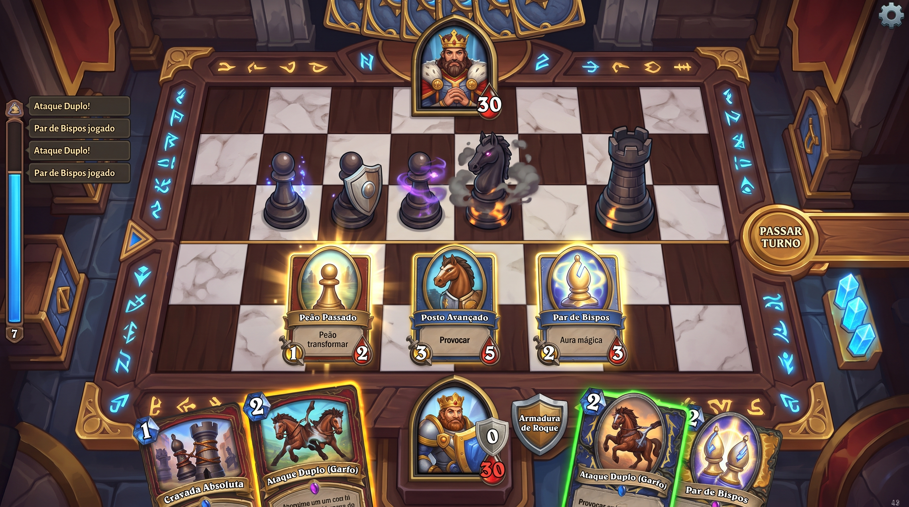

# Chess Stone



Prototipo 2D de card game de xadrez para um jogador contra IA, em Python 3.10+,
**pygame-ce** e **python-chess** (pacote `chess`). Sem imagens externas;
regras e efeitos independem da interface. As cartas da mao usam interpolacao
exponencial independente do FPS para zoom, elevacao e inclinacao ao passar o mouse.

## Executar

No PowerShell, na raiz do projeto:

```powershell
python -m venv .venv
.\.venv\Scripts\python.exe -m pip install -r requirements.txt
.\.venv\Scripts\python.exe main.py
```

Para um deck menor e resultados reproduziveis:

```powershell
.\.venv\Scripts\python.exe main.py --deck-size 12 --seed 42
```

## Manual do jogador

Consulte o **[MANUAL.md](MANUAL.md)** para controles, regras de combate,
palavras-chave, Final de jogo, condicoes dos seis mates, colecao, crafting e
montagem de decks. Este README concentra instalacao e documentacao tecnica.

## Persistencia e integracao

Os arquivos locais `data\decks.json` e `data\collection.json` sao criados no
primeiro salvamento/resgate e ignorados pelo Git. Decks sao um objeto JSON
que associa nomes a listas de IDs:

```json
{
  "Peoes e Torres": ["peao", "peao", "torre"],
  "Teste rapido": ["cavalo", "bispo", "dama"]
}
```

O inventario registra o historico de recompensas. Variantes tem IDs estaveis,
como `torre__improved` e `torre__perfect`; seus atributos sao derivados
deterministicamente do catalogo base em `crafting.py`.

Os puzzles usam a [API oficial Lichess](https://lichess.org/api#tag/Puzzles/operation/apiPuzzleNext)
(`GET /api/puzzle/next?angle=...`). A associacao entre cartas e temas fica em
`crafting.py`; os temas e as regras de recompensa estao no
[manual](MANUAL.md#crafting-por-puzzles-lichess).

## Estrutura

| Arquivo | Responsabilidade |
|---|---|
| `MANUAL.md` | Regras e guia do jogador |
| `main.py` | Estados Menu/Colecao/Puzzle/Deck builder/Partida/Fim, desenho, cliques, agenda da IA sem bloquear eventos |
| `collection_view.py` | Catalogo com busca, filtros, detalhes, disponibilidade e entrada do crafting |
| `crafting.py` | Temas por carta, qualidades, variantes e inventario persistente |
| `chess_puzzles\` | Modulo independente de puzzles: download Lichess, validacao, sessao e resultado |
| `puzzles.py` | Imports de compatibilidade para o modulo `chess_puzzles` |
| `puzzle_view.py` | Tabuleiro de xadrez no Pygame, requisicoes em segundo plano e resgate |
| `ui_theme.py` | Paleta de cores compartilhada pelas telas |
| `hand_view.py` | Animacao da mao, ordem de desenho e deteccao de cliques nas cartas transformadas |
| `audio.py` | Impactos genericos pre-carregados e reproducao imediata ao aplicar dano |
| `tools\generate_impacts.py` | Geracao reproduzivel dos sons originais de impacto |
| `deck_store.py` | Validacao de decks e persistencia local em JSON |
| `game_engine.py` | Estado, jogadas legais, combate, turnos, compras, Final de jogo e IA |
| `mate_rules.py` | Formacoes anunciadas, cancelamento e vitorias alternativas |
| `effect_parser.py` | Resolucao de alvos, condicoes e execucao ordenada dos efeitos |
| `csv_to_json.py` | Conversao e validacao do catalogo; utilizavel sem pygame |
| `data\cards.csv` | Fonte editavel em planilha, UTF-8 e delimitador virgula |
| `data\cards.json` | Catalogo validado carregado pelo jogo |
| `tests\` | Testes de dados, regras, cliques da interface e partidas completas reproduziveis |

## Reutilizar os puzzles em outro jogo

Copie a pasta `chess_puzzles\` para o outro projeto e instale `chess>=1.11.2,<2`.
O modulo nao depende de pygame, cartas, interface ou persistencia do Chess Stone.
`download_puzzle` e sincrono; execute-o em uma thread se a interface nao puder
esperar pela rede. O tema e um identificador da API Lichess, nao um ID de carta.

```python
import chess
from chess_puzzles import PuzzleError, PuzzleSession, download_puzzle

try:
    puzzle = download_puzzle("fork", user_agent="MeuJogo/1.0")
    session = PuzzleSession(puzzle)
    # Para cada tentativa do jogador:
    correct = session.play(chess.Move.from_uci("e2e4"))
    if session.result is not None:
        result = session.result
        print(result.quality, result.errors, result.elapsed, result.player_moves)
except PuzzleError as error:
    print(error)  # error.retry_after informa o tempo de espera, se aplicavel.
```

O lance do exemplo deve ser substituido pelo lance escolhido pelo jogador.
Um lance incorreto incrementa `errors` sem alterar o tabuleiro; um correto
aplica tambem a resposta do adversario, quando existir. `result` e `None`
antes da conclusao e depois retorna um `PuzzleResult` imutavel com ID, tema,
rating, erros, tempo em segundos, numero de lances do jogador e qualidade.
O tempo e a qualidade ficam congelados ao concluir; abandonar nao produz resultado.

A classificacao padrao e `perfect` (sem erros, ate 60 segundos por lance),
`improved` (ate um erro, ate 120 segundos por lance) ou `basic` (demais casos).
Outro jogo pode fornecer `PuzzleSession(puzzle, grader=funcao)`, onde a funcao
recebe `(errors, elapsed, player_moves)` e retorna uma string de classificacao.
A propriedade `quality` durante a sessao e uma previa, nao um resultado final.
Cada jogo decide suas recompensas e persistencia; o Chess Stone conserva as regras
padrao e o formato existente da colecao.

## Imagens e sons das cartas

A pasta `assets\cards\` possui uma subpasta para cada ID de carta do catalogo,
alem de `rei` para o Rei. Coloque a imagem e os sons juntos na pasta da carta:

O fundo da partida usa `assets\board.jpg` (2626 x 1600); a geometria das casas
corresponde aos quadrados dessa imagem.

```text
assets\
  cards\
    peao\
      art.png
      on_play.ogg
      on_attack.ogg
      on_death.ogg
      on_effect.ogg
    cavalo\
    bispo\
    torre\
    dama\
    cravada_absoluta\
    ataque_duplo\
    par_de_bispos\
    coluna_aberta\
    zugzwang\
    sacrificio_da_dama\
    mate_anastasia\
    mate_boden\
    mate_abafado\
    mate_gaveta\
    mate_opera\
    endgame_puro\
    peao_passado\
    rei\
```

Os arquivos mostrados em `peao` sao exemplos de nomes; nenhuma imagem ou som
foi incluido. Use essa mesma convencao em cada pasta: `art.png` para a arte,
`on_play.ogg` ao jogar, `on_attack.ogg` ao atacar, `on_death.ogg` ao morrer e
`on_effect.ogg` para o efeito. Prefira PNG com transparencia e audio OGG ou WAV
(`on_play.wav`, por exemplo). Eventos que nao se aplicam a uma carta podem
ficar sem arquivo.

Para artes/sons exclusivos das qualidades, use subpastas opcionais `improved`
e `perfect` dentro da pasta base, por exemplo
`assets\cards\torre\perfect\art.png`. Para novas cartas, crie uma pasta com o
mesmo `id` do CSV, sem acentos ou espacos.

Os arquivos `.gitkeep` apenas preservam as pastas vazias no Git e podem ser
removidos depois de adicionar seus recursos. **Esta estrutura ainda nao carrega
nem reproduz os arquivos no jogo**; a interface continua minimalista.

### Sons genericos de impacto

O jogo ja reproduz os impactos originais incluidos em `assets\sounds\impacts\`:
`light.wav` para 1-2 de dano, `medium.wav` para 3-4 e `heavy.wav` para 5 ou mais.
Sao sons sintetizados, sem recursos de terceiros, com duracoes de 120, 180 e
260 ms, respectivamente. Podem ser recriados com:

```powershell
python tools\generate_impacts.py
```

Os WAVs sao carregados uma vez ao iniciar. O motor notifica o cliente
sincronamente logo apos descontar a vida; o som e iniciado nesse mesmo ponto,
sem esperar o proximo frame, percorrer o log ou usar temporizadores. Isso cobre
ataques do jogador/IA, contra-ataques, manobras, efeitos em area, dano letal e
fadiga, inclusive contra o Rei. Cada alvo atingido dispara um impacto;
impactos simultaneos podem se sobrepor. Cura, destruir sem dano, dano zero e
dano absorvido por Proteção nao disparam o som.

O mixer usa buffer de 256 amostras a 44,1 kHz (aproximadamente 5,8 ms por buffer),
volume de 45% e pelo menos 16 canais. A latencia audivel final tambem depende do
driver e do dispositivo; nao e possivel garantir latencia fisica zero. Nenhuma
reproducao bloqueia o loop. Se o dispositivo ou os WAVs estiverem indisponiveis,
o jogo continua com aviso visivel no menu/partida e detalhes no console.
Os sons especificos de `assets\cards\` continuam sem carregamento automatico.

## Editar as cartas

Exporte uma planilha como CSV UTF-8 com o cabecalho exato:

```text
id,name,piece_type,piece_cost,attack,health,keywords,piece_effect,manouver_effect,description
```

**Toda carta tem os dois modos**, escolhidos ao jogar. `piece_type` aceita
`peao`, `cavalo`, `bispo`, `torre` ou `dama`. `piece_cost` (inteiro de 0 a 10)
e o custo em Tempo **de ambos os modos**. Ataque, vida e palavras-chave pertencem
somente a Peca; ataque e vida sao obrigatorios. `keywords` aceita identificadores
ingleses ou nomes portugueses separados por `|`. `piece_effect` pode ficar
vazio; `manouver_effect` exige ao menos um efeito imediato.

Exemplo de linha CSV:

```csv
peao,Peao,peao,1,1,2,,"{""trigger"":""on_death"",""action"":""draw"",""amount"":1}",DRAW:1:SELF,Peca: compra 1 ao morrer. Manobra: compra 1.
```

O conversor gera objetos separados, sem os antigos campos planos `type`,
`category`, `cost` ou `effects`:

```json
{
  "id": "peao",
  "name": "Peao",
  "piece_mode": {
    "piece_type": "peao",
    "cost": 1,
    "attack": 1,
    "health": 2,
    "keywords": [],
    "effects": [{"trigger": "on_death", "action": "draw", "amount": 1}]
  },
  "manouvre_mode": {
    "cost": 1,
    "effects": [{"trigger": "on_play", "action": "draw", "amount": 1}]
  },
  "description": "Peca: compra 1 ao morrer. Manobra: compra 1."
}
```

As grafias `manouver_effect` (CSV) e `manouvre_mode` (JSON) fazem parte do
contrato. Efeitos `win_pattern` geram `"rarity": "legendary"` na carta,
preservando a restricao dos mates no deck em ambos os modos.
IDs permanecem unicos e estaveis; decks e colecoes existentes continuam validos.

```powershell
python csv_to_json.py
python csv_to_json.py data\cards.csv data\cards.json
```

O conversor rejeita custos/atributos invalidos, IDs duplicados, palavras-chave,
acoes, alvos e gatilhos desconhecidos, alem de referencias a cartas inexistentes.
O jogo revalida o JSON ao carregar. Apenas `on_play` solicita alvo manual;
manobras nao podem usar gatilhos futuros, pois nao permanecem no tabuleiro.
Uma conversao invalida nao substitui o catalogo existente.

### API modal do motor

`Game.play_card(owner, card, target=None, position=None, *, mode="piece")`
aceita `mode="piece"` ou `mode="manobra"`. Peca exige casa livre (usa a primeira
se `position` for omitida); Manobra nao aceita `position`, funciona com tabuleiro
cheio e vai para `Player.discard` apos resolver. Somente os efeitos do modo
escolhido sao executados. Erros de custo, modo, casa, alvo ou requisitos de mate
sao rejeitados antes de gastar Tempo ou remover a carta da mao.

`playable(owner, card, mode=None)` considera qualquer um dos modos quando o
modo e omitido. `valid_card_targets` e `manual_effects` aceitam modo, com padrao
`"piece"`. `Card.mode(mode)` retorna o objeto correspondente do JSON.
`Unit.piece_type` determina alcance e formacoes; `card_id` identifica a carta
base e `definition_id` preserva sua variante. Manobras, pecas mortas (exceto Rei)
e compras com mao cheia sao registradas no descarte; nao ha reciclagem automatica.

### Efeitos

Vitoria alternativa usa `{"trigger":"on_play","action":"win_pattern","pattern":"anastasia"}`.
Os padroes aceitos sao `anastasia`, `boden`, `smothered`, `back_rank`, `opera` e
`opposition`, apenas em manobras lendarias. O parser encaminha a
acao para o modulo de regras de mate; padroes desconhecidos sao rejeitados.

O formato curto aceita `DAMAGE`, `HEAL`, `DRAW` e `FREEZE`, separados por `|`:

```text
DAMAGE:2:TARGET_2_ENEMIES|DRAW:1:IF_KILLED
```

Isso gera dano a ate duas peças inimigas **distintas com menor Vida**,
desempatando pelo menor casa, com compra de uma carta **por peça abatida**.
Proteção nao conta como abate. Os efeitos nao usam RNG; decks continuam
embaralhados e a IA pode escolher alvos manuais aleatoriamente.
`DRAW:1:SELF` compra para o dono da carta. Para efeitos complexos, use um objeto
ou uma lista JSON na celula; planilhas normalmente escapam as aspas na exportacao.

```json
[
  {
    "trigger": "on_play",
    "action": "buff",
    "attack": 2,
    "duration": "until_end_of_turn",
    "target": "target_ally_piece"
  },
  {
    "trigger": "on_play",
    "action": "grant_keyword",
    "keyword": "rush",
    "target": "target_ally_piece"
  }
]
```

As acoes sao executadas na ordem. Cada acao de area aplica suas alteracoes antes
de resolver mortes. Todos os efeitos manuais de uma mesma jogada compartilham um
unico alvo, valido para todos eles. Uma peça com alvo manual primeiro exige
posicionamento e depois selecao de alvo. `on_kill` e um objeto de acao adicional,
executado por abate e sem solicitar novos alvos.

Gatilhos da Peca: `on_play`, `on_death`, `on_turn_start`, `on_turn_end`.
Ambos os campos de efeito CSV usam `on_play` por padrao; outros gatilhos
exigem JSON estruturado com `trigger`. Manobras aceitam somente `on_play`.

Acoes: `damage`, `heal`, `buff`, `draw`, `summon`, `freeze`, `grant_keyword`,
`destroy`, `activate_king`. Dano/cura/compra exigem `amount`; `summon` usa
`card_id` e `count` opcional. `buff` usa `attack`/`health` positivos ou zero;
apenas ataque aceita duracao `until_end_of_turn`. `grant_keyword` usa `keyword`.
Congelamento tem duracao fixa; `amount` no formato curto de FREEZE nao altera isso.

Alvos: `self`, `own_hero`, `enemy_hero`, `target_enemy`, `target_enemy_piece`,
`target_ally`, `target_ally_piece`, `all_enemies`, `all_enemy_pieces`,
`all_allies`, `all_allied_pieces`, `adjacent_allies`, `lowest_health_enemy`,
`lowest_health_enemy_piece`. `self` e a peça de origem ou o Rei para manobras.
`adjacent_allies` usa casas fixas imediatamente vizinhas; lacunas interrompem
a adjacencia. Seletores `lowest_health_*` aceitam `count`, ordenam por Vida e
desempatam pela casa (Rei fora do tabuleiro vem depois das casas em empates).
Os alvos sao definidos antes da resolucao da acao.
Seletores antigos `random_*` sao rejeitados pela validacao.
O filtro opcional `card_id` aceita a identidade base da carta ou um arquetipo
de `piece_type`: `"bispo"` tambem seleciona Cravada Absoluta desenvolvida como
Bispo. `summon.card_id` continua exigindo um ID exato do catalogo e desenvolve
apenas o modo Peca, sem executar efeitos de entrada.

Cada `Unit.slot` identifica uma posicao fixa de 0 a 5; `Player.board` contem
apenas peças ocupantes, ordenadas por casa. `unit_at` e `free_slots` consultam
ocupacao sem compactar o tabuleiro. Apoio modifica somente dano de combate, antes de
Proteção/Armadura; o bonus de Centro adiciona 1 tempo por um unico turno,
sem elevar o limite permanente de 10 de tempo. Veja o manual para as regras.

A condicao suportada e `{"type":"friendly_count","card_id":"bispo","at_least":2}`,
utilizada em Par de Bispos. Se nao atendida, a acao e ignorada com registro no
log; o custo da jogada continua sendo pago. Sacrificio da Dama exige uma Dama
aliada selecionavel, a destroi e executa dano em area seguido de compras.
Essa contagem tambem aceita o arquetipo: qualquer carta desenvolvida como Bispo
conta para Par de Bispos, independentemente do nome ou qualidade.

## Verificacoes

```powershell
python -m unittest discover -s tests -v
python main.py --smoke-test
```

Os testes de interface e o segundo comando usam o driver SDL dummy, sem janela.
Para executar somente as regras, sem depender de pygame, use
`python -m unittest discover -s tests -p test_game.py -v`.
Os testes de decks usam arquivos temporarios e nao alteram sua biblioteca.
Os testes de crafting tambem usam arquivos temporarios e respostas de rede
simuladas; nao dependem de internet nem modificam o inventario local.

### TODO

- Vamos adicionar classes de heroes que seriam os campeões de chess. Seriam 4 classes dos perfis de jogadores, ativista, pragmático, reflector, teorista.